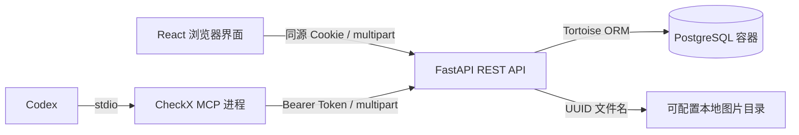
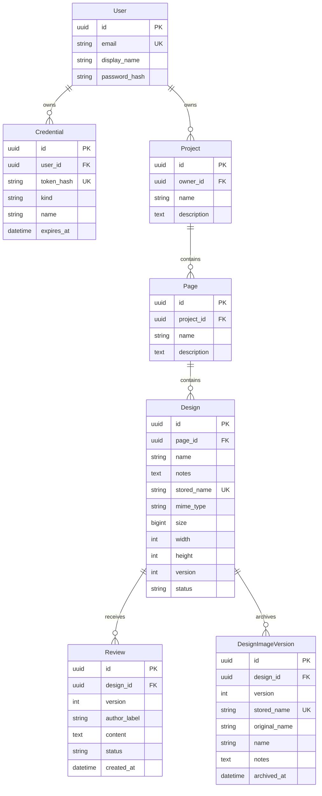

# 架构与数据设计

## 运行结构

MCP 是 REST API 的客户端，不直接访问数据库、共享 ORM 上下文或绕过归属校验。MCP 进程可以在设计师电脑上运行，而后端与文件目录位于另一台服务器；上传路径是 MCP 所在电脑的路径。

## 数据模型

归档表另含图片格式、字节大小和宽高，`(design_id, version)` 唯一。最新图片保存在 Design，DesignImageVersion 只存过去版本的文件元数据。除归档表使用归档时间外，各实体还含创建时间，项目/页面/设计图含更新时间。ID 为 UUID，时间存储为 UTC，界面转换为浏览器本地时间。外键由数据库约束并建立索引。不同账号的数据隔离至 Project.owner，所有嵌套资源访问都沿这条关系检查。

## 认证与共享账号

- 邮箱由 Pydantic 验证格式后转小写，数据库唯一约束处理并发注册冲突。
- 密码保留原始空格，8–128 字符，Argon2 哈希。密码处理在线程池中执行。
- 每次注册/登录签发一个随机的独立会话令牌，数据库仅存 SHA-256 摘要。支持多浏览器、多人并行登录。
- 浏览器使用 HttpOnly + SameSite=Lax Cookie；退出仅删除当前凭据。HTTPS 部署可启用 Secure。
- MCP 使用单独的 `kind=api` Bearer Token，有期限、可撤销，无法利用 API Token 再签发新 Token。
- 各个账号可以自主创建自己的项目，账号之间不能相互访问。返回 404 隐藏他人的资源是否存在。
- 浏览器写请求检查 Origin；跨域白名单显式配置，不使用凭据通配源。

## 图片存储

1. ASGI 中间件为包括 chunked 请求在内的请求体设置硬上限，使用有界临时 spool，避免无界内存占用。
2. `UploadFile` 分块读取，限制单图大小。
3. Pillow 根据文件内容识别 PNG/JPEG/WebP，验证结构并实际解码；限制像素，拒绝损坏文件和 SVG。
4. 后端生成 UUID 文件名及真实格式扩展名；用户名称、原始文件名只作为元数据，不参与路径构造。
5. 文件写入可配置目录，数据库记录归属、名称、备注、尺寸、媒体类型和相对存储名。数据库写入失败时清理本次文件。
6. 原图通过鉴权路由读取，使用 `private, no-store` 和 `nosniff`；不挂载公开静态目录。
7. 删除设计图先删除数据库记录及级联审阅、版本归档，再删除所有版本的文件。文件清理失败会记录日志，可能留下孤立文件，但不会破坏其他记录。
8. MCP 上传传入 `overwrite=true`，按页面和原始文件名匹配。所有上传先锁定页面行，覆盖再锁定设计图行，避免并发首次上传产生重复记录；历史重复匹配返回 409。覆盖和按 ID 更新共用事务：归档旧版本及其存储名、递增 Design.version、替换最新图片元数据并重置待审阅；旧文件保留。删除也锁定设计图后读取最新及全部归档存储名，避免并发更新造成文件遗漏。图片 URL 含文件版本参数，让前端在覆盖后重新加载。

文件系统和数据库不属于同一事务。进程在写入与提交之间异常退出可能留下孤立文件；备份/恢复需要同时处理两类存储。当前未增加定时清理任务。

## 审阅与并发

新设计图状态为 `pending`。审阅者选择 `changes_requested` 或 `approved`，填写非空意见，可填写署名。

提交审阅时在数据库事务中对该设计图 `SELECT FOR UPDATE`，校验可选的 expected_version 后，将当前版本写入 Review.version，再更新 Design.status。因此多人同时审阅不会互相覆盖历史；同一图的审阅按串行提交顺序生效，最新记录与最终状态一致。

编辑设计图名称/备注使用显式 `update_fields`，不会用旧对象上的状态覆盖其他人的新审阅。审阅记录不开放编辑，允许通过列表或详情页的删除图标确认后永久删除；必须属于当前账号及指定设计图。删除与提交、覆盖图片共用设计图行锁，在同一事务内删除记录并更新状态：只按当前版本的剩余最新记录计算状态，该版本删完恢复待审阅，旧版审阅永远不会恢复新版状态。删图仍会连同其历史删除。项目与页面编辑是最后提交生效。

## 前端设计

- React Router：登录、项目列表、项目详情、独立审阅视图、设置页。
- 首页直接显示项目，没有全局侧栏；仅项目详情左侧展示页面列表，右侧展示当前页面设计图。
- 全局顶部头像菜单提供设置与退出。设置页使用横向账号/MCP 分类，旧 `/integrations` 地址重定向至 `/settings?tab=mcp`。
- 列表采用最小宽度 490px 的瀑布流卡片，ResizeObserver 根据卡片实际高度计算网格行跨度，保留 DOM 顺序；窄屏自动单列。图片链接进入详情页，信息区显示当前版本号、完整备注及最新 3 条审阅记录，每条意见标注所属版本；列表与详情均只加载最新图片。卡片内可直接通过（记录「审阅通过」），或展开多行修改意见并确定/取消。提交刷新状态、审阅记录及项目统计；右侧审阅面板已移除。
- 账号信息保存至后端：名称可直接修改；修改邮箱需校验当前密码并处理唯一冲突；修改密码保留当前会话、撤销其他浏览器会话，MCP 令牌独立管理。
- React Query：缓存、失效刷新、轮询和错误状态。401 清理缓存并返回登录。
- 原生 `dialog`：弹窗焦点限制、键盘 Esc、遮罩交互；提交期间禁止关闭，避免重复提交。
- 多图队列逐个上传，展示每个文件的状态。部分失败保留成功项，再次上传只提交失败项。
- 审阅原图画布支持适应尺寸及缩放，超大图片可滚动；手机布局改为原图在上、意见在下。
- 数据库中的业务文本均由 React 作为普通文本渲染，不注入 HTML。

## 后续扩展点

- 高流量场景：批量统计查询、缩略图、前端列表虚拟化、游标分页、共享限流。
- 多主机部署：将存储接口替换为对象存储或共享卷。
- 协作增强：WebSocket/SSE、图上定位批注、独立成员身份与权限、历史版本预览和恢复。
- 多实例发布：单独运行迁移任务，避免多个副本同时迁移。

这些属于后续范围，当前没有为未实现能力展示可点击的入口。
